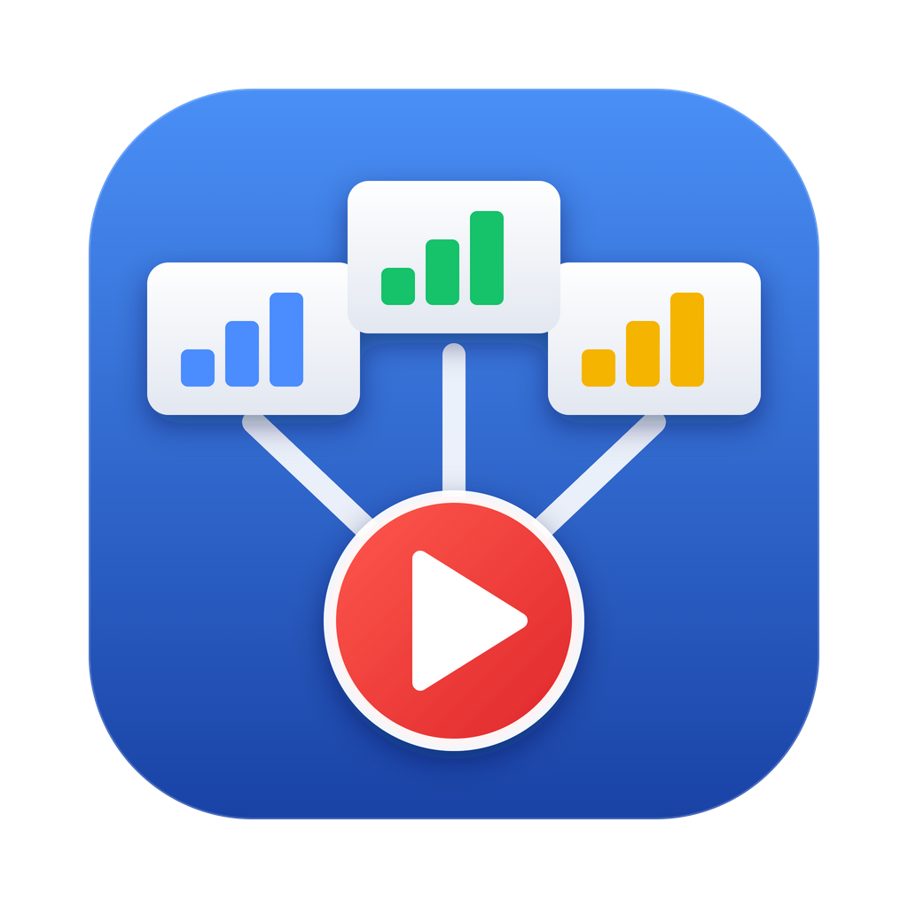
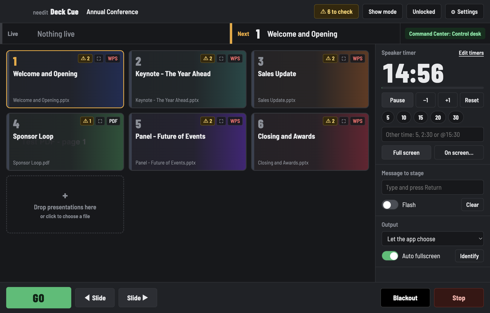
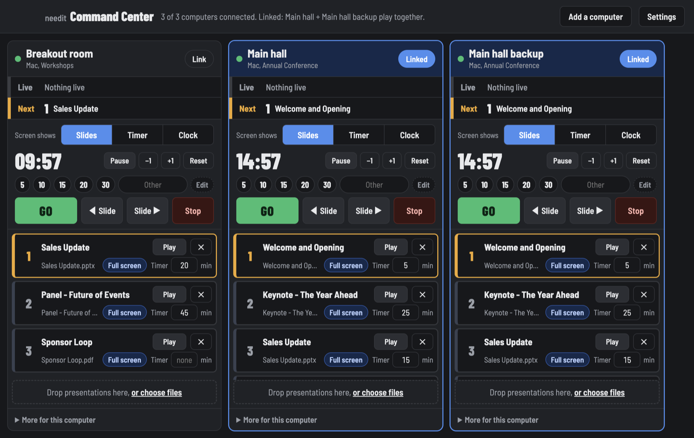

<p align="center">
  
  &nbsp;&nbsp;
  
</p>

# needit Deck Cue and needit Command Center

Free and open source presentation cueing for live events, for macOS and Windows. Created by **[needit Creative](https://needitcreative.com)** for AV operators.

There are two apps:
- **needit Deck Cue** runs on every computer that shows presentations. Each presentation is a big cue button: press it and the deck opens full screen on the right output. It works with **Microsoft PowerPoint**, **WPS Office**, **Keynote** and **PDF** files (PDFs play in a player built into the app).
- **needit Command Center** runs on one computer and controls every Deck Cue on the network: send the files, set the order, press play, run the timers. Main and backup can be linked so they always play together.





## What it does

- **Cue buttons:** drop presentations in, press a cue or **GO**, and the deck opens and starts its slideshow. Keyboard shortcuts per cue, also while the slideshow is in front.
- **No file juggling:** files dropped from a USB stick are copied into a show folder on the computer. Dropping a newer file on a cue replaces the old one, so only the latest version is there.
- **Command Center:** one seat runs many computers. Files are sent over the network; nobody walks around with sticks.
- **Link:** main and backup start the same cue at the same moment.
- **Speaker timer:** saved timers, a timer per presentation, +1 / −1 minute while it runs. Show it full screen, as a clock between presentations, or as a small overlay on top of the slides.
- **Stage display and presenter remote:** a confidence monitor page for any browser, and a phone remote for the presenter (with a PIN).
- **Preflight:** warns about missing fonts, wrong slide shape for the output and missing files before the show.
- **Show-machine mode:** keeps notifications, sleep and screen savers out of the way.
- **Remote control:** Bitfocus Companion module (Stream Deck), HTTP and WebSocket API, OSC and MIDI.

## Download

[](https://github.com/unilordgr/needit-deck-cue/releases/latest)

### needit Deck Cue

Runs on every computer that shows presentations.

| Platform | | |
|---|---|---|
| **Windows** 10/11 x64 | Installer, with a Start menu shortcut | [](https://github.com/unilordgr/needit-deck-cue/releases/latest/download/needit-Deck-Cue-Setup.exe) |
| **Windows** 10/11 x64 | Portable: nothing to install, runs from a USB stick | [](https://github.com/unilordgr/needit-deck-cue/releases/latest/download/needit-Deck-Cue-Portable.exe) |
| **macOS** Apple Silicon | M1 or later | [](https://github.com/unilordgr/needit-deck-cue/releases/latest/download/needit-Deck-Cue-mac-arm64.zip) |

### needit Command Center

Runs on the one computer that controls the others.

| Platform | | |
|---|---|---|
| **Windows** 10/11 x64 | Installer, with a Start menu shortcut | [](https://github.com/unilordgr/needit-deck-cue/releases/latest/download/needit-Command-Center-Setup.exe) |
| **Windows** 10/11 x64 | Portable: nothing to install, runs from a USB stick | [](https://github.com/unilordgr/needit-deck-cue/releases/latest/download/needit-Command-Center-Portable.exe) |
| **macOS** Apple Silicon | M1 or later | [](https://github.com/unilordgr/needit-deck-cue/releases/latest/download/needit-Command-Center-mac-arm64.zip) |

### Bitfocus Companion module

For Stream Deck and other Companion surfaces.

| | | |
|---|---|---|
| **Companion** 4.0 or newer | Import it under *Modules › Import module package* | [](https://github.com/unilordgr/needit-deck-cue/releases/latest/download/needit-deckcue-companion.tgz) |

> All releases: [github.com/unilordgr/needit-deck-cue/releases](https://github.com/unilordgr/needit-deck-cue/releases). More about the apps: [needitcreative.com/software](https://needitcreative.com/software).

### Opening the apps the first time

The apps are free and are not yet signed with an Apple or Microsoft developer certificate, so both systems ask before they open them. See the [code signing policy](#code-signing-policy).

- **macOS:** unzip, move the app to *Applications* and open it. macOS says it can't check the app. Open **System Settings › Privacy & Security**, scroll down and press **Open Anyway**. You only do this once.
- **Windows:** SmartScreen shows *Windows protected your PC*. Press **More info**, then **Run anyway**.

## Updates

Both apps look for a new version when they start. When one is out, a blue **Update** button appears at the top of the window.

- **Update now** downloads the new version, checks it, installs it and opens the app again. It takes a few seconds once the download is done. It is refused while a presentation is live or Show mode is on, so an update never lands in the middle of a show.
- **Install new versions automatically** (off unless you switch it on, in *Settings › About and updates*) downloads a new version in the background and installs it when you close the app. The next time you open it, it is up to date.
- **From the Command Center:** each computer's card says when a newer Deck Cue is out, with an **Update** button; with several, the top bar has *Update N computers*. A show computer without internet gets the new version from the Command Center over the show network.
- You can switch the check off in the same Settings page. *Check for updates* there looks right away.

**What is checked before anything is installed.** Every release carries a list of its builds with their SHA-256, signed with a key that only the release build has. The apps hold the public half. A download, or a package passed along by a Command Center, is used only if the list's signature is good and the file matches the list.

**How each build updates**
- *Windows, installer:* the new installer runs without questions and starts the app again.
- *Windows, portable:* the `.exe` is replaced where it is, so it keeps working from a USB stick.
- *macOS:* the app is replaced where it is. If macOS started it straight from the Downloads folder, move it to *Applications* first. The apps are not signed by Apple yet, so after an update macOS asks once more for the Accessibility permission (*Settings › This computer* has the button).

**Status:** on macOS a real update was run end to end (update now, automatic on closing, and from the Command Center to a computer without internet). On Windows the two install paths are run on the build machine with every release (the installer silently over itself, and the portable replace script), but the whole update has not been tried on a real PC yet.

## Quick start

**One computer**
1. Open **needit Deck Cue**.
2. Drop your presentations on the window. Each one becomes a cue.
3. Click a cue, or press **GO** (Space) for the next one. **Esc** stops.

On a Mac, the first cue makes macOS ask to let Deck Cue control your presentation app: press **OK**. WPS Office also needs *Accessibility* permission; ⚙ Settings › This computer has a button for it.

**Several computers**
1. Put all the computers on the same network.
2. On each show computer open Deck Cue, go to **Settings › Command Center** and switch on **Connect to Command Center**.
3. Open **needit Command Center** on your own computer. The show computers appear by themselves. Drop presentations on them and press play.

## Status: early release

This is version 0.x: new, and not every combination has been run yet. **Rehearse on the real setup before a show.**

| | State |
|---|---|
| macOS with **WPS Office** and **PDF** | Tested end to end on one display |
| macOS with **PowerPoint** and **Keynote** | Written from Apple's and Microsoft's scripting documentation; not yet run against the real apps |
| **Windows** (PowerPoint, WPS Office, PDF) | The builds are made and checked automatically; not yet tested on a real PC with PowerPoint or WPS |
| **Command Center** | Tested with three copies of Deck Cue on one Mac; not yet tested between separate computers |
| Sending a slideshow to a chosen second display | Not yet tested with a real second display |
| **Updates** | Tested end to end on macOS; on Windows only the install steps are checked automatically |

Found a problem? Please [open an issue](https://github.com/unilordgr/needit-deck-cue/issues) and say which system and presentation app you use.

## Command Center

Connect all the computers to the same network (a simple switch is enough). The Command Center then shows every show computer as a column, and you run the whole event from one seat.

**Setup**
1. Open **needit Deck Cue** on each show computer.
2. In its **Settings › Command Center**, switch on **Connect to Command Center**.
3. Open **needit Command Center** on your own computer. The show computers appear by themselves. If one doesn't, press **Add a computer** and type the address its Settings page shows.

**What you can do from the Command Center**
- **Send presentations:** drop files on a computer. They are copied to a folder on that computer (by default `needit Deck Cue` in the home folder) and added as cues. Drop on a cue to replace its file; drop on empty space to add.
- **Order them:** drag cues up and down.
- **Play them:** GO, Play on any cue, Stop, next and previous slide. Click a cue to make it the next one.
- **Choose per cue** whether it opens **Full screen** or **Just opens**, and give it a **timer** that starts when it plays.
- **Choose what the screen shows:** Slides, a full-screen **Timer**, the **Clock**, or the **Card** (the event card: an image such as the event's logo slide; the first click asks for the image and sends it). Under *More*: what to show between presentations (nothing, the timer, the time or the event card), the event card's image, a small timer on top of the slides with **where it sits** (nine places) **and how big it is** (S, M, L), and Blackout.
- **Choose the screen the slideshows go to** on each computer (*More › Slideshows go to*). The list shows that computer's own screens. Two laptops for one talk: link them, send both the same presentation, and choose a different screen on each. For speaker notes, choose the laptop's *own* screen on the notes laptop: the presentation app then puts its presenter view (notes) on the other screen, if presenter view is switched on in that app. (That part is the presentation app's doing and has not been tried by us yet. WPS Office on Windows and Keynote choose their screen themselves.)
- **Run the timer:** saved timers with one click, Start/Pause, −1 and +1 minute while it runs, another time, or `@15:30` to count down to a time of day.

**Changing a presentation during the event**
- Press the **pencil** on a cue. The Command Center fetches that presentation from the show computer and opens it in the presentation app of *your* computer. Change it and save it as usual. The cue then says *Saved here at 14:32. Not on the show computers yet.* Press **Send the new version** and it goes to that computer and to the linked ones (the old version goes to their Trash). Nothing is sent by itself, because apps also save on their own half-way through a change.
- A cue that is playing keeps showing the old version until you play it again.
- The files you edit are kept in `needit Command Center/Editing` in your home folder.
- **Changed on a show computer instead?** (Someone pressed Esc there, fixed a slide and saved.) That computer's Deck Cue notices by itself and marks the cue UPDATED. If computers are linked, the Command Center compares the files themselves, not only their names, and says *The linked computers do not have the same file for cue 3*, which one is the newest, and offers **Copy the newest to the others**.

**Files from a USB stick**
Drop files straight from the stick. They are copied to the show computers, so the stick can be taken out.
- Drop a file **on a cue** and you are asked whether to replace that cue's file. The old file goes to the Trash on that computer.
- Drop a file with the **same name** as one that is already there and you choose: **Replace** (it is the new version; the old one goes to the Trash) or **Keep both** (it is another presentation; it is saved as `Name (2)`). The question shows both dates and warns when the file you are sending is the older one. Capitals do not matter: `deck.pptx` and `Deck.pptx` are the same name.
- A file is never written over another cue's file. Two speakers who both bring `Presentation.pptx` both keep their deck.

**Link: computers that play together**
Press **Link** on two or more computers. They get a shared blue frame, and from then on anything you do on one happens on all of them:
- Play, GO, Stop and slides
- the timer and the screen mode
- files you drop (so a main and its backup get the same list in one go)
- changes to a cue: order, full screen, timer, remove

Cues are matched by their position in the list. Before anything is done to a cue on another linked computer, the Command Center checks that the cue in that position is the same presentation there; if it is not, nothing is done on that computer and you are told. **GO** plays the cue that is next on the computer you press it on, on all of them. You get a warning when the lists or the next cue differ, and a loud one in the top bar when a linked computer is not connected.

**Linking a computer that is already set up:** when you link a second computer to one that already has its list, the Command Center offers to copy everything across: the presentations, the cues with their settings, and the saved timers. If the lists drift apart later, the warning has a **Copy this list to the others** button.

**Safety**
- A show computer only accepts files after you switch on *Connect to Command Center* on it.
- It only takes presentation files (PowerPoint, Keynote, PDF), and only into its project folder.
- Set the same **network key** on the show computers and in the Command Center's Settings to keep other people on the network from sending files or changing the list. The key can be any text. It does not lock the play controls (GO, Stop, timer), which Stream Deck and Companion use without a key.
- The show computers keep their own list. If the Command Center or the network goes away, they carry on and can be run locally.

**Status:** tested on one Mac with several copies of Deck Cue and the Command Center (discovery, sending files, ordering, playing, timers, Link). Not yet tested between separate computers, or on Windows.

## Presentation apps
Deck Cue detects which apps are installed (⚙︎ Settings › System lists them).
- **.ppt / .pptx / .pps(x) / .dps** open with the app chosen in ⚙︎ Settings › *Open .ppt / .pptx with*. **Auto** uses the first one installed, in the order PowerPoint, WPS Office, Keynote.
- **.key** files always open in Keynote.
- **.pdf** files always play in the built-in PDF player.
- Any cue can override this in its editor (*Open with*).

| | PowerPoint | WPS Office | Keynote | PDF |
|---|---|---|---|---|
| How it's controlled | AppleScript | Its menus, through Accessibility | AppleScript | Built-in player |
| Accessibility permission | Only for routing to an output | **Always required** | No | No |
| Sends to a chosen output | Yes | Yes (best effort) | No (Keynote chooses; press X) | **Yes** |
| Tested | Not yet (not installed on the dev Mac) | **Yes, WPS 12.1** | Not yet | **Yes** |

**PDF player**
- Each page is shown fitted to the screen on black, on the cue's output. If the output is *Let the app choose*, it uses the first external display, or the main display if there's none.
- **Start slide** sets the first page.
- While a PDF is live, Deck Cue takes the clicker keys (→ ← ↑ ↓ Page Up / Page Down) from any app, so a presentation clicker works even when another window has focus. When the PDF ends, those keys go back to normal. While Deck Cue's own window is in front, only Page Up / Page Down are taken: there the arrows keep working in the cue list and in the text boxes (← → still change the page).
- In the player window you can also click for the next page, right-click for the previous one, type a number and press Return to jump, use Home / End, or press Esc to stop.
- With the cue's *Fullscreen* set to *Just open*, the PDF opens in your default PDF app instead.

**WPS Office notes**
- WPS has no scripting support, so Deck Cue clicks *Slide Show › Play*, types the slide number to jump, and sends arrow keys and Esc. Menu names are matched in **English**, so keep WPS's interface language set to English.
- WPS can't close a deck while a slideshow is running. With *Close the previous presentation* on, Deck Cue closes the old deck *before* starting the next one, so the editor shows for a moment during the change. Turn on *black backdrop* in Settings to hide it on the output.
- Don't leave a dialog open in WPS (Save, Recover, etc.). Deck Cue can't click Play while one is showing.

## Timers

- **Saved timers:** the row of numbers under the timer. One click sets a timer and starts it. **Edit timers** adds, renames or removes them (up to ten); they are saved with the show.
- **While it runs:** **−1** and **+1** change the time by a minute. Start/Pause and Reset as usual.
- **Another time:** type `5`, `2:30` or `1:00:00` and press Return. Type `@15:30` to count down to that time of day.
- **Per presentation:** give a cue a *Timer (min)*. It starts by itself when that cue plays.
- The bar under the time shows how much has been used. The time turns amber for the last two minutes and red when over.

## Timer on the output screen

The speaker timer can also be shown on the output itself, in three ways. Set it up with **On screen…** in the timer panel.

- **Between presentations**: while nothing is live, the output shows a full-screen **timer** or the **current time**, with an optional title above it ("Starting in", "Back at 15:30"). It stays up while the next cue loads, then gives way to the slides. Stop brings it back.
- **Corner overlay**: while a presentation is live, a small timer (or the current time) sits on top of the slideshow. It works over PowerPoint, WPS, Keynote and the PDF player. The overlay is see-through to clicks and never takes keyboard focus, so clickers and the slideshow are unaffected.
- **Full screen button**: puts the timer full screen over whatever is playing, right now. Use it for a Q&A countdown, or as a countdown clock with no presentations at all.

**Overlay layout.** In the editor, drag the timer on the preview to move it, and drag its corner dot to resize it. You can also choose:
- what it shows (timer or current time)
- the background (solid, see-through or text only)
- an optional label ("Time left")
- one of the four corners, with one click

*Show it on the screen now* displays the overlay while you set it up.

**Which screen.** It follows the show's output by default (or the first external screen); you can pick another one. The automatic full screen never covers the screen Deck Cue itself is on, so it needs a second screen. The Full screen button always works; on a single screen, click the timer to hide it.

**Behaviour**
- The timer turns amber for the last two minutes and red with "+MM:SS" when over time.
- Blackout covers the timer too.
- Remote: `POST /api/timerscreen[?state=on|off][&content=timer|clock|card]`, OSC `/deckcue/timerscreen [0|1]`, or the Companion *Timer: full screen on the output* action. Without `state` it toggles: it hides whatever is up (a clock too), or shows the timer. A backup machine follows the Full screen and Event card buttons.

**Event card.** One image for the output, for example the event's logo slide (PNG or JPG, ideally the size of the screen; it is fitted on black, never cut or stretched). Choose it under **On screen…**, or send it from the Command Center. Then either press **Event card** to put it up now, over anything that is playing, or choose *Between presentations: The event card* and it appears by itself whenever no presentation is live: it covers the app while a cue loads and comes back the moment you press Stop. The image is kept in the show folder. Blackout covers it.

Tested on macOS over a fullscreen WPS slideshow and the PDF player. Not yet tried over PowerPoint or Keynote, or on Windows.

## The show folder

Presentations you drop into Deck Cue are **copied into the show folder** on that computer (by default `needit Deck Cue` in the home folder), and the cue plays the copy. A USB stick can be taken out straight away.
- Dropping a file **on a cue** asks before replacing its file. The old file goes to the Trash, so the folder holds only the latest versions and a mistake can be undone.
- Dropping a file whose **name is already in the folder** asks what it is: **Replace** (the new version of that presentation; the old one goes to the Trash) or **Keep both** (a different presentation with the same name; it is saved as `Name (2)`). The question shows both dates and warns when the file you added is the older one. Capitals do not matter.
- A file is never written over another cue's file. Dropped on cue 1, a `Presentation.pptx` that is a different deck from cue 7's `Presentation.pptx` is saved under its own name.
- Dropping the very same file again does nothing.
- **Videos and sounds that a PowerPoint file links to** (instead of containing them) are copied along when they sit beside the presentation or in a folder beside it, so the copy plays them too. Links to a fixed place on the disk, or to the internet, are left as they are; Preflight lists the ones that cannot be found.
- While a large file is being copied, the status line says *Copying …*.
- A show that was made on another computer finds its presentations in this computer's show folder by their names.
- Settings › Playing presentations has the switch (*Copy presentations into this computer's show folder*) and the folder. With the switch off, cues play files from where they are.

## Versions of files

Speakers change their decks until the last minute. Deck Cue watches every cue's file. This works on network shares and USB drives too.
- **UPDATED** (blue): the file changed on disk. If that cue is live, you're told that the running show still has the old version; fire the cue again to load the new one (Deck Cue closes the old version first, so the app really opens the new file).
- **NEW VERSION** (amber): a newer file with the same name in the same folder. Version markers are recognised: `_v7` → `_v8`, `FINAL` → `FINAL 2`, `rev4` → `rev5`, `(3)`, `copy`. A bare number is not a version: "Day 2" and "Day 3", or `Session_1` and `Session_2`, stay separate decks. A file that another cue plays is never offered as a newer version. The cue editor offers **Use it** or **Ignore**.
- **Settings › Newer version of a file in its folder** chooses *Show it and ask* (default), *Switch to it automatically* or *Ignore*.

## Thumbnails

Each cue button shows its first slide. On macOS, Quick Look renders any deck or PDF, with no Office needed. On Windows, Deck Cue uses the preview PowerPoint saves inside the `.pptx`, and pdf.js for PDFs. The stage display shows the next cue's thumbnail too.

## Presenter remote (phone)

Turn it on in **Settings › Presenter remote**. Speakers scan the QR code, or open `http://<deck-cue>:9640/remote` and enter the PIN.
- They get large **NEXT / PREV** buttons, the current slide, the slide number, the timer and your stage messages.
- A Bluetooth clicker paired with the phone works too.

**Safeguards**
- Only NEXT and PREV are available to presenters.
- Five wrong PINs lock that device out for a minute. **New PIN** changes it.
- The **PRESENTER** chip in the status bar pauses it instantly (also from Companion or `POST /api/presenter/mute`).
- Untick a cue's *Presenter remote can change slides* to keep that cue operator-only.
- Presses go through Deck Cue, so a backup machine follows them.

## Live slide number

While a cue is live, Deck Cue reads which slide is showing, once a second:
- **macOS:** PowerPoint and Keynote
- **Windows:** PowerPoint and WPS (through one long-running PowerShell)
- **PDF:** always

The slide number feeds the stage display, presenter remote, Companion and OSC. A backup catches up to the exact slide where the app allows jumping (PDF, Windows PowerPoint/WPS, Keynote). **WPS for Mac** can't report its slide (no scripting), so it is followed with next/previous only.

## MIDI

**Settings › MIDI › Listen to MIDI.** It works with any connected MIDI device or virtual port (IAC, a lighting desk, QLab…):
- **Notes** fire cues. Note 60 (middle C) = cue 1, 61 = cue 2… The base note is adjustable.
- **Program Change** n fires cue n+1.
- **MIDI Show Control**: GO with a cue number fires that cue, GO without one is the GO button, and STOP / ALL_OFF stop.
- **Learn** maps any note, CC or program change to GO, Stop, Next slide, Previous slide or Blackout.
- You can filter the input and channel, and the panel shows the last message received.

## Program window (NDI / OBS capture)

Choose the output **Program window (for NDI / OBS capture)** for a PDF cue. It plays in a normal 16:9 window titled *needit Deck Cue — Program* instead of on a screen. NDI Tools *Screen Capture*, OBS (with its NDI plugin) or vMix can capture that window by name and send it as NDI, without needing a spare monitor. PowerPoint, WPS and Keynote can't render into a window, so for those cues capture their output screen instead.

Deck Cue doesn't send NDI itself. That needs the proprietary NDI SDK as a native add-on.

## Show-machine mode

One switch (**Show mode** in the top bar) makes the computer safe to run a show from.

**While it's on:**
- **No sleep, screensaver or power-saving slowdowns.** The display stays awake, and Deck Cue keeps full speed in the background, so timers, sync and remote control never stall.
- **Notifications are silenced:**
  - *Windows*: app notifications are turned off. The previous setting comes back when show mode turns off or Deck Cue quits.
  - *macOS*: Apple gives apps no way to switch Do Not Disturb. Make two Shortcuts once, `Deck Cue Show On` (Set Focus → Do Not Disturb → On) and `Deck Cue Show Off` (→ Off), and show mode runs them. The panel explains how and opens the Shortcuts app.
- **A SHOW MODE badge** appears in the status bar, and quitting asks for confirmation.

**Readiness checks in the panel:**
- **Apps that can pop up over a show:** Slack, Teams, Zoom, Webex, WhatsApp, Telegram, Signal, Discord, Skype, Messages, FaceTime, Mail, Outlook, Spotify, Dropbox, OneDrive, Google Drive, Creative Cloud, Microsoft AutoUpdate. **Quit them** asks them to close (never forced), and only when you click it.
- **Running on battery.**
- **Sound muted or at 0** (macOS).
- **Less than 5 GB free disk space.**
- **Where the sound plays**, with a warning for the computer's own speakers while a projector is connected, or for Bluetooth.

**Turn on when Deck Cue starts** keeps it on for a dedicated show machine. It can also be switched remotely: `POST /api/showmode[?state=on|off]`, OSC `/deckcue/showmode [0|1]`, or the Companion *Show-machine mode* action.

## Preflight

Deck Cue checks every cue on **this computer** and shows the result:
- a badge on each cue: ✓, ⚠ with the number of things to check, or ✕ when it won't play
- a list in the cue editor
- a **Preflight** button in the top bar ("✓ Ready", "⚠ 2 to check", "✕ 1 won't play") that opens the full report

Checks run when you add or change cues, when screens are connected, and each time you switch back to Deck Cue (after fixing a deck or installing a font, for example).

**What it checks**
| | |
|---|---|
| File | missing, password-protected, no slides, start slide beyond the last slide, hidden slides, very large files, old `.ppt` format |
| Fonts | every font the deck uses, including theme fonts. Fonts embedded in the deck count as present; so do fonts installed on the computer or bundled with PowerPoint/WPS |
| Screen | slide shape (4:3, 16:9…) against the cue's output screen ("4:3 slides on a 16:9 output: black bars at the sides"), and output screens that aren't connected. While only the computer's own screen is connected the shape is a note, not a warning |
| Video and audio | linked media that can't be found, media streamed from the internet, formats a Mac can't play (WMV, AVI…), and a reminder to rehearse video in WPS |
| Computer | presentation app not installed; WPS without Accessibility permission (Mac) |

Fonts, media and slide details are read from `.pptx`/`.ppsx`/`.potx` files and PDFs (page count, page shape, password). Keynote and old `.ppt` files get the file, app and screen checks.

In Companion, *Cue has preflight problems* and *Show has preflight problems* can colour buttons, and the `preflight` variable gives the summary.

## Main / backup

With a Command Center, the simplest way to run a main and a backup is to **Link** the two computers there (see *Command Center*). The built-in pairing below needs no Command Center: the backup follows the main directly.

Run the same show on two computers. Each feeds the video switcher, and the **backup follows the main** in step:
- cue fires, stop, next/previous slide and blackout
- the NEXT cue
- for PDF cues, the exact page
- the speaker timer and stage messages

If the main fails, cut the switcher to the backup and keep going from the backup's own GO, keys or Companion.

**Setup** (⚙︎ Settings › Main / backup):
1. On the main computer choose **Main**. This also allows other computers in Remote control.
2. On the backup choose **Backup** and enter the main's address and port (shown in the main's Settings).
3. Make both shows match: copy the show folder to both computers, or press **Copy show from main** on the backup. Files are matched by name if their folder is different.

**How it stays in step**
- **Actions are sent instantly**, so both machines load together.
- The main also sends its full state every few seconds. The backup corrects any drift: a missed cue, a backup that joined mid-show, or a PDF page moved by its own clicker.
- If the two shows don't line up, the backup says which cues differ.

**Status bar**
- On the main: *MAIN · backup connected: <name>*. It turns amber and says so when a connected backup is not really following: its show is different, or it is holding (see Fail-safe).
- On the backup: *BACKUP · following <main>*, or a flashing **MAIN LOST** warning.

**Fail-safe:** after losing the main, the backup **holds**. A restarted main with nothing live will not stop the backup's show. Following resumes at the main's next deliberate action (a cue, a slide, stop).

**Limits**
- Slide changes made directly in PowerPoint/WPS/Keynote on the main (for example, a clicker plugged into the main) can't be seen. Send slide changes through Deck Cue: its slide buttons, global *Next slide* keys, Companion or OSC. Or use a clicker that drives both machines (e.g. DSAN PerfectCue).
- Exact-page correction works for PDF cues. Other cues follow next/previous.

To test both roles on one computer, start a second copy with its own settings: `open -n "needit Deck Cue.app" --args --profile=backup` (macOS), or `"needit Deck Cue.exe" --profile=backup` (Windows). Then give it different ports in Settings.

## Stage display (confidence monitor)

Open `http://<deck-cue-computer>:9640/stage` in any browser: a monitor on the stage, a tablet on the lectern, or a laptop at front of house. ⚙︎ Settings › Remote control shows the exact link and has **Open stage display** buttons. A device other than this computer needs *Allow other computers on the network* turned on.

It shows:
- the **live cue** with its slide number, and a **preview of the current and next page** for PDF cues
- the **next cue**
- the cue's **notes** (from the cue editor), as speaker notes
- a large **countdown timer** that turns amber in the last 2 minutes and red with "+MM:SS" when over time, plus the time of day
- **operator messages** as a banner across the top, optionally flashing

`/stage?view=timer` shows only the timer, for a dedicated countdown monitor. The page adapts to portrait tablets and phones.

**Operator controls** are in the bar at the bottom of the main window:
- *Timer*: type `5`, `2:30` or `1:00:00` and press Return to set it. ▶/⏸ starts and pauses, ⟲ resets.
- *Message*: type and press Return to show it on stage. ⚡ makes it flash, ✕ clears it.

Each cue can have a **Timer (min)**. When that cue fires, the timer restarts with that duration (*Settings › Start the speaker timer when a cue with a timer fires*). The timer and messages can also be controlled over the API, OSC and Companion (below).

## Remote control: Bitfocus Companion, Stream Deck, OSC

Deck Cue can be driven from a show controller. Turn it on and set ports in **⚙︎ Settings › Remote control**; these settings belong to the computer, not the show file.
- By default only programs on the same computer can connect.
- Tick **Allow other computers on the network** when Companion or the lighting desk is on another machine. Settings then shows the address to use.

### Bitfocus Companion
The module in `companion-module/` (Companion 4.0 or newer) provides:
- **Actions:** GO, Stop, Blackout (toggle/on/off), next/previous slide, fire a cue, arm a cue, arm next/previous.
- **Feedbacks:**
  - Cue is live (red), Cue is next (yellow), Cue is loading, Cue file missing
  - Blackout, Something is live
  - Cue colour (the colour set in Deck Cue)
- **Timer and message actions:** start/pause/reset/set/add time, show or clear a stage message (feedback: running, nearly done, over time, message showing).
- **Variables:** `live_name`, `next_name`, `slide_text` (PDF cues), `timer`, `stage_message`, `cue_N_name` and more.
- **Presets:** a Transport page, one button per cue that turns yellow when next and red when live, a Timer page (live countdown, 5–30 min, ±1 min) and a Stage messages page (WRAP UP, 5 MIN, …).

To install it:
1. Download `needit-deckcue-companion.tgz` with the [download button](#download) above, or build it yourself (`cd companion-module && npm install && npm run package`).
2. In Companion, import it under *Modules › Import module package*.
3. Add a **needit Deck Cue** connection with the host and port shown in Deck Cue's settings.

### HTTP + WebSocket API (default port 9640)
| | |
|---|---|
| `GET /api/state` | Full state: cues (number, id, name, colour, state), live cue + slide, next cue, blackout |
| `POST /api/go`, `/api/stop`, `/api/next`, `/api/prev` | Transport |
| `POST /api/blackout[?state=on\|off]` | Toggle, or set |
| `POST /api/cue/<number\|id\|name>/fire` · `/arm` | Fire or arm a cue |
| `POST /api/arm/next`, `/api/arm/prev` | Move the NEXT cue |
| `POST /api/timer/start`, `/pause`, `/reset`, `/set?seconds=N`, `/add?seconds=N` | Speaker timer (negative `add` removes time) |
| `POST /api/timer/preset?n=N`, `/api/timer/until?time=HH:MM` | Start a saved timer; count down to a time of day |
| `GET /api/info`, `PUT /api/files/<name>`, `POST /api/cues`, `/api/cue/<ref>/file`, `/update`, `/move?to=N`, `/delete` | Command Center: identify, receive files, manage cues (only when the computer accepts a Command Center; optional header `X-DeckCue-Key`) |
| `POST /api/message?text=…&flash=1`, `/api/message/clear` | Stage message |
| `POST /api/showmode[?state=on\|off]` | Show-machine mode (toggle without state) |
| `POST /api/timerscreen[?state=on\|off][&content=timer\|clock\|card]` | Full-screen timer, clock or event card on the output. Without state it toggles: hides what is up, or shows the timer |
| `POST /api/presenter/mute[?state=on\|off]` | Pause / allow the presenter remote |
| `POST /api/presenter/next`, `/prev`, `/check` + header `X-Presenter-Pin` | Presenter remote (PIN) |
| `GET /api/cue/<ref>/thumb` | First-slide thumbnail |
| `GET /remote` | Presenter phone remote |
| `GET /stage`, `/stage?view=timer` | Stage display page |
| `ws://host:9640/api/ws` | Pushes `{"type":"state","state":…}` on connect and on every change |

### OSC (UDP, default port 9641)
- **Input:**
  - `/deckcue/go`, `/deckcue/stop`, `/deckcue/next`, `/deckcue/prev`
  - `/deckcue/blackout [0|1]`
  - `/deckcue/cue/fire <n|id>`, `/deckcue/cue/arm <n|id>`, `/deckcue/cue/<n>/fire`, `/deckcue/cue/<n>/arm`
  - `/deckcue/arm/next`, `/deckcue/arm/prev`
  - `/deckcue/timer/start`, `/pause`, `/reset`, `/deckcue/timer/set <seconds>`, `/deckcue/timer/add <seconds>`
  - `/deckcue/message <text> [flash 0|1]`, `/deckcue/message/clear`
- **Feedback:** sent to the host:port set in Settings, and for an hour to anything that sends `/deckcue/state` (which also gets the full state at once). Only values that change are re-sent.
  - `/deckcue/live/number i`, `/deckcue/live/name s`
  - `/deckcue/next/number i`, `/deckcue/next/name s`
  - `/deckcue/blackout i`
  - `/deckcue/slide i i` (current, total; 0 when unknown)
  - `/deckcue/cue/<n>/state s`, one of `live`, `next`, `loading`, `missing` or `idle`

The current slide is only known for PDF cues so far. PowerPoint, WPS and Keynote don't report slide changes yet.

## Windows

Deck Cue also runs on Windows 10/11 (x64). There it controls **PowerPoint** and **WPS Office** through COM automation, using the built-in Windows PowerShell; no extra permissions are needed. PDFs use the same built-in player as on the Mac. Keynote doesn't exist on Windows.

There are two builds:
- **Installer**: `needit-Deck-Cue-Setup.exe`. Installs normally, with a Start menu shortcut.
- **Portable**: `needit-Deck-Cue-Portable.exe`. Nothing to install, so it can run from a USB stick. Its settings and autosave are kept in a `needit Deck Cue Data` folder next to the `.exe`.

**Choosing the output on Windows**
- *PowerPoint*: Deck Cue sets PowerPoint's slide-show monitor (`DisplayMonitor` in `HKCU\Software\Microsoft\Office\16.0\PowerPoint\Options`) to the cue's output before starting the show.
- *WPS Office*: WPS picks its own display. Set it in WPS under *Slide Show › Set Up Show*.
- *PDF*: goes to the chosen output directly.

**Status:** the Windows build has **not yet been tested with PowerPoint or WPS** on a real PC. CI checks that every Windows script parses, and runs the ones that work without PowerPoint (detect running apps, list monitors). Rehearse before a show.

## Build from source

You need [Node.js](https://nodejs.org) 22 or newer.

```bash
npm install
npm start
```

`npm start` opens Deck Cue. `npm run start:center` opens the Command Center.

To make the apps:

| | Deck Cue | Command Center |
|---|---|---|
| macOS | `npm run dist:mac` (output in `dist/`) | `npm run dist:center:mac` (output in `dist-center/`) |
| Windows | `npm run dist:win` | `npm run dist:center:win` |

Both apps come from the same code. The Command Center build uses `builder-center.json`, which marks the package as the Command Center; `src/index.js` then starts `src/center/` instead of the player.

Windows builds can't be made on an Apple Silicon Mac, so GitHub Actions makes them (`.github/workflows/build.yml`). *Actions › Build › Run workflow* builds everything and keeps the files on the finished run. Pushing a `v*` tag also publishes them on the Releases page, together with the signed update list (`update.json`, made by `scripts/make-update-list.js` with the `UPDATE_SIGNING_KEY` secret). A release without that list is not offered to the apps as an update.

## Using it

| Action | How |
|---|---|
| Create cues | Drag `.pptx` / `.ppt` / `.pps(x)` / `.key` / `.pdf` files onto empty space or the **+** tile. Several files create several cues. |
| Replace a cue's file | Drag a file onto an existing cue button. |
| Reorder | Drag a cue button onto another one. |
| Fire a cue | Click it, press its shortcut, or press **GO** to fire the NEXT cue. |
| Arm a cue as NEXT | ⌥-click it, or use ↑ / ↓. |
| Edit a cue | Hover and click ✎, or right-click the cue. |
| Lock | 🔒 stops accidental drags, edits and deletes. Cues still fire. |

**Per-cue settings:** label, file, app (auto / PowerPoint / Keynote), **Fullscreen** (Default / Start slideshow / Just open), start slide, **Output** (Default / Let PowerPoint choose / a specific display), shortcut (+ Global), color, notes.

**Keys while Deck Cue is in front:** Space = GO, Esc = Stop all, ← / → = previous / next slide, B = Blackout.

**After a restart:** Deck Cue comes back where the show was: the same next cue, the speaker timer still counting, the stage message still up.

**GO at the end:** after the last cue, GO does nothing. A held Space or a double press plays one cue, not two.

**Stop closes the presentation.** Stop ends the slideshow and closes that presentation in its app (the app itself stays open), so a day of fifteen cues does not leave fifteen open windows. Settings › Playing presentations has the switch (*Stop also closes the presentation*) if you would rather keep them open. (Checked with WPS Office on macOS.)

**Closed by hand:** if you close a presentation yourself, or quit PowerPoint, Keynote or WPS Office, Deck Cue notices within a few seconds and the cue is no longer shown as live. (Checked with WPS Office on macOS; the PowerPoint, Keynote and Windows checks are written but not yet run against the real apps.)

### Shortcuts: local vs global
- A **local** shortcut works only while Deck Cue is the front window. Any key is allowed.
- A **global** shortcut (🌐) works even while PowerPoint is in front. It must use ⌘, ⌃ or ⌥, or an F-key (F13–F19 are ideal for a Stream Deck or keypad). Plain keys can't be global, because they would steal Space, arrows and B from your clicker in the slideshow.
- Global GO / Stop / Blackout / Next / Prev are set in ⚙︎ Settings.

### Outputs (which screen the slideshow goes to)
PowerPoint has no scriptable setting for the slideshow display, so Deck Cue uses this approach:
- **Let PowerPoint choose:** a normal slideshow. With 2 screens and Presenter View on, slides go to the external screen.
- **A specific display:** Deck Cue runs the slideshow in window mode, moves it to that display, and makes it native fullscreen there. This needs **System Settings › Privacy & Security › Accessibility** permission for Deck Cue. Display mirroring must be off.
- **Identify** flashes a number on each display.
- Keynote picks its own display. Press **X** during a Keynote show to move it to another screen.

### Blackout
A black window covers the output display (the default output, or every non-main display). It sits above the slideshow. Press B or the button again to remove it.

### Show files
⌘S / ⌘O save and open `.deckcue` files. Work is autosaved, so quitting never asks to save: the show comes back as it was the next time Deck Cue opens. If a file has moved, Deck Cue looks for it next to the show file and then in this computer's show folder, so you can copy a show folder to another machine.

## First run on the show machine
1. Fire a cue. macOS asks to let Deck Cue control your presentation app (and System Events). Click **OK**.
2. Allow Deck Cue in **System Settings › Privacy & Security › Accessibility**. WPS Office needs this always, and PowerPoint needs it for per-display outputs. ⚙︎ Settings has a button that opens this page.
3. **Rehearse on the real projector setup.** The PowerPoint scripting could not be tested on the development machine (see below).

## Status / not yet verified
- **WPS Office** was tested end to end on one display:
  - cold start
  - start slide
  - next slide
  - changing cue while another app had focus
  - closing the previous deck
  - Stop

  Sending a show to a *specific* second display with WPS has **not** been tested (no second screen was connected).
- **PowerPoint / Keynote**: their scripts were written from documentation and have **not been run against the real apps**.
- Rehearse on the real setup before a show. The scripts are in `src/drivers/` (`mac.js` and `win.js`).

Test decks for a quick check are in `test-decks/`.

## License

**Free and open source.** needit Deck Cue and needit Command Center are licensed under the [GNU General Public License, version 3](LICENSE) or (at your option) any later version.

In short: you may use the apps for anything, including paid shows and events, and you may copy, change and share them. If you pass on a changed version, it must stay open under the same license, with its source. Nobody can turn the apps into a closed product.

The Bitfocus Companion module in `companion-module/` is under the MIT License, as Companion modules are. Third-party components are listed in [THIRD-PARTY-NOTICES.md](THIRD-PARTY-NOTICES.md).

Copyright © 2026 needit Creative.

## Code signing policy

**Status:** the Windows builds are not signed yet. This project is applying for free code signing from [SignPath.io](https://signpath.io), with a certificate by [SignPath Foundation](https://signpath.org). This is the policy that will apply. The macOS builds are not part of it.

- **What is signed:** only the Windows installers and portable builds that GitHub Actions makes from this repository (`.github/workflows/build.yml`). Nothing built elsewhere is signed.
- **Committers and reviewers:** [needit Creative](https://github.com/unilordgr). Changes from anyone else are reviewed before they are merged.
- **Approvers:** [needit Creative](https://github.com/unilordgr). Every release is approved by hand before it is signed.

**Privacy:** apart from the version check described next, this program will not transfer any information to other networked systems unless specifically requested by the user or the person installing or operating it. The apps talk only to other copies of needit Deck Cue and needit Command Center, and to the remote controls you connect, on your own network. They have no accounts and no analytics.

**The version check:** when an app starts, and every six hours while it runs, it downloads a small list of the latest version from this project's GitHub Releases. Nothing about you, your computer or your shows is sent with it. You can switch it off in *Settings › About and updates*. A new version is downloaded only when you press Update, or when you have switched on automatic updates.

**System settings:** Show mode silences notifications and keeps the computer awake while it is on, and puts the previous settings back when it turns off. On Windows, choosing an output for a PowerPoint cue sets PowerPoint's slide-show monitor. Both happen only when the operator asks for them, and both are described in this README.

**Removing the apps:** on Windows, use *Settings › Apps* (the installer adds an uninstaller); the portable build is a single file to delete, together with the `Data` folder it keeps next to itself. On macOS, move the app to the Trash.

## Credits

Created by **[needit Creative](https://needitcreative.com)**.

Microsoft PowerPoint, Keynote, WPS Office, Stream Deck and Bitfocus Companion are trademarks of their owners. needit Deck Cue controls those apps; it is not affiliated with or endorsed by them.
